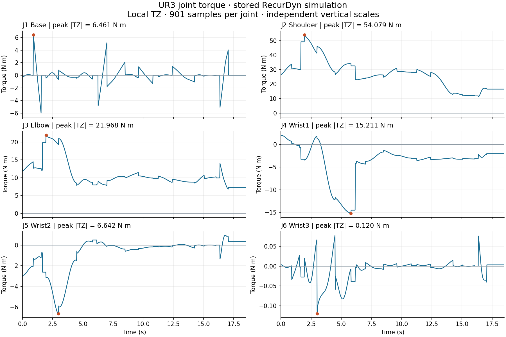

# UR3 부품 이송·삽입 시뮬레이션

**스크류를 세우고 베어링을 끼우는 18.5 s 경로를 구성하고, 토크 좌표축을 바로잡아 J2의 최대 관절 하중 54.079 N·m를 확인했습니다.**

2026년 1학기 시스템동역학 · 강태욱 · RecurDyn 2023 / Python


**볼 점:** 같은 0–18.5 s 해석의 901개 저장 시각에서 J2 성분을 TY → 로컬 TZ로 바꾸면 6.093 → 54.079 N·m입니다. 운동 성능 개선이 아니라 **하중 해석 오류의 정정**입니다.

[모션·구속 정의](model/SystemDynamics_UR3_pick_place_screw_bearing.rmd) · [후처리 코드](scripts/postprocess_results.py) · [원시 Request](results/solver/UR3_v81_clean_optimized.req) · [결과 CSV](results/motor_capacity_summary.csv)

## 해결한 문제와 구현

제공된 UR3 CAD로 두 물체를 목표 위치까지 옮기고, 관절에 필요한 토크를 구하는 수업 프로젝트입니다. CAD 형상을 바탕으로 6축 조인트와 작업물 구속을 구성하고, 작업 경로·STEP 모션·토크 Request를 설정했습니다. 실물 로봇 시험 없이 **RecurDyn 다물체 시뮬레이션**으로 수행했습니다.

### 1. 스크류 배치부터 베어링 삽입까지 경로 구성

스크류와 베어링에 각각 5개 핵심 웨이포인트를 두고, 집기·유지·놓기 구간을 포함해 20개 모션 상태로 나눴습니다. 단일 강체 그리퍼와 물체 사이의 OnOff 구속을 전환해 이송하고, 베어링을 놓은 뒤에는 수직 가이드로 하강시켰습니다.

| 입력·설정 | 구성한 동작 | 확인할 자료 |
| --- | --- | --- |
| 스크류 접근·집기·상승·배치·후퇴 위치 | 1.55 s 집기 → 5.80 s 배치 → 7.00 s 후퇴 | [핵심 경유점](data/pp_waypoints.csv) |
| 베어링 접근·집기·정렬·삽입·후퇴 위치 | 10.80 s 집기 → 16.05 s 삽입 → 17.05 s 후퇴 | [20개 관절 자세](data/joint_table.csv) |
| 6축 STEP 모션, hold/grip/guide 구속 | 18.5 s까지의 경로와 관절 하중 저장 | [모션·구속 정의](model/SystemDynamics_UR3_pick_place_screw_bearing.rmd) · [해석 조건](docs/reproduction.md) |

위 시각은 경로의 지정 상태입니다. [기하 검토 표](data/clearance_audit.csv)의 여유 값은 지정 형상·목표 위치에 대한 계산이며, 전 경로 충돌 검사나 실제 파지 시험 결과는 아닙니다.

<details>
<summary>작업 순서 개념도</summary>


AI로 제작한 설명용 개념도이며 실제 모델 캡처·동작 영상이 아닙니다. [그림 안내](assets/README.md)

</details>

### 2. 토크 좌표축 오류를 찾아 하중 재계산

기존 후처리는 J2·J3·J4·J6에 TY를 사용했습니다. RMD에서 Request의 기준 마커가 조인트의 J 마커와 같은지 확인하고, 회전축 성분을 여섯 관절 모두 로컬 TZ로 통일했습니다. Python 코드에 조인트 종류·I/J/RM 연결·단위 검사를 넣어 다른 조건의 데이터를 그대로 계산하지 않도록 했습니다.

같은 원시 결과에서 N·mm를 N·m로 환산하면 J2의 샘플 최대값은 **54.079 N·m**이며, **1.953 s**에서 나타납니다. 안전율 1.5 적용값은 **81.119 N·m**입니다. 이 값은 관절 출력축의 하중 기준으로, 실제 모터 선정에는 감속비·효율·속도·RMS 토크 검토가 추가로 필요합니다.

[수정 전후 수치와 축 선택 근거](docs/torque_review.md) · [수정 전 CSV](data/original/motor_capacity_summary.csv) · [계산 기록](results/verification.json)

<details>
<summary>6축 토크 시계열과 최대값</summary>



관절별 세로축 범위가 다르며 주황색 점은 절댓값 최대 샘플입니다. [시계열 CSV](results/torque_timeseries.csv) · [그래프 코드](scripts/plot_torque.py)

| 관절 | 샘플 최대 토크 (N·m) | 안전율 1.5 적용 (N·m) |
| --- | ---: | ---: |
| J1 · Base | 6.461 | 9.691 |
| J2 · Shoulder | 54.079 | 81.119 |
| J3 · Elbow | 21.968 | 32.953 |
| J4 · Wrist 1 | 15.211 | 22.817 |
| J5 · Wrist 2 | 6.642 | 9.963 |
| J6 · Wrist 3 | 0.120 | 0.180 |

</details>

## 결과 확인과 실행

**Python 3.10 이상**에서 아래 명령으로 원시 Request를 다시 읽어 저장 CSV 두 개와 검증 JSON이 계산 결과와 일치하는지 확인합니다. 추가 패키지나 RecurDyn 실행은 필요하지 않습니다.

```bash
git clone https://github.com/ktw25079/System_Dynamics.git
cd System_Dynamics
python scripts/postprocess_results.py --check
```

```text
PASS: six local-TZ requests, 901 samples per joint, 0-18.5 s; committed results match
```

Windows에서는 `python`, 환경에 따라 `python3`를 사용합니다. [후처리·그래프 실행 안내](scripts/README.md)

저장소만으로 토크 후처리와 그래프를 재현할 수 있습니다. 제공 CAD의 재배포 권한을 확인하지 못해 형상이 포함된 RDYN은 별도 보관했으며, 동작 재생·솔버 재해석에는 그 원본이 필요합니다. [텍스트 모델과 파라미터](model/README.md) · [원본 보유 시 해석 절차](docs/reproduction.md). 이번 정리에서는 저장 결과를 재계산했으며 솔버를 새로 실행하지 않았습니다.

## 파일 안내

| 경로 | 내용 |
| --- | --- |
| [model/](model/README.md) | 조인트·모션·Request 텍스트 정의와 파라미터 |
| [data/](data/README.md) | 경유점·관절 자세·기하 검토·정정 전 토크 |
| [results/](results/README.md) | 현재 토크 결과와 원시 솔버 출력 |
| [scripts/](scripts/README.md) | 토크 계산·결과 검사·그래프 생성 |
| [docs/](docs/README.md) | 요구사항·모델 구성·재현 절차·정정 근거·출처 |
| [assets/](assets/README.md) | 결과 그래프와 작업 순서 개념도 |

## 수행 범위와 출처

제공된 `UR3.step`과 매니퓰레이터 강의 예제를 바탕으로 한 수업 프로젝트입니다. 구현 범위는 작업물·경로·조인트 모션·구속 전환과 관절 하중 후처리입니다. 제공된 로봇 CAD 자체를 설계한 작업으로 소개하지 않습니다.

강체 그리퍼와 지정 모션을 사용하며 실제 마찰 파지, 자유낙하, 접촉 충격, PID 제어는 해석하지 않았습니다. 기존 보고서의 접촉 설명·토크 축·베어링 치수와 최종 모델의 차이는 [정정 내역](docs/errata.md)에 구분했습니다.

[과제 요구사항](docs/requirements.md) · [모델링 범위](docs/model.md) · [파일 출처와 해시](docs/source_manifest.json)
