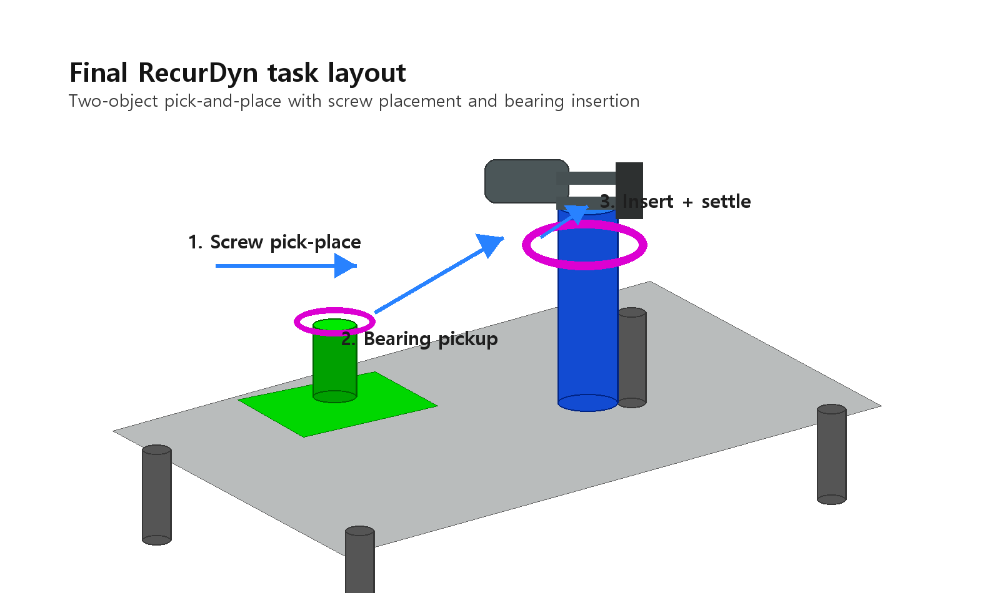

# UR3 Pick & Place

**2026년 1학기 시스템동역학 프로젝트 · 강태욱**  
RecurDyn 2023 · 6축 매니퓰레이터 · 스크류 이송 및 베어링 삽입

## 목적

UR3가 스크류를 목표 위치에 세운 뒤, 베어링을 이송해 스크류에 수직으로 끼우는 시뮬레이션입니다. CAD 기반 동역학 모델링부터 경로 설정, 관절 토크 분석까지의 결과를 정리했습니다.

[모델 열기](model/SystemDynamics_UR3_pick_place_screw_bearing.rdyn) · [실행 안내](docs/reproduction.md) · [과제 조건](docs/requirements.md) · [토크 분석](docs/torque_review.md)



<sub>작업 순서를 설명하는 개념도입니다. 실제 해석 화면이나 축척 도면은 아닙니다.</sub>

## 진행 과정

CAD 형상으로 6축 로봇과 작업물을 구성하고, 웨이포인트와 조인트 모션을 설정한 뒤 해석 결과에서 관절별 토크를 계산했습니다.

### 작업 순서

| 단계 | 수행 동작 |
|:---:|---|
| **01 · Pick** | 스크류에 접근하여 집고 들어 올립니다. |
| **02 · Place** | 스크류를 목표 위치로 옮겨 수직으로 배치합니다. |
| **03 · Align** | 홀더의 베어링을 집어 스크류 상부에 동축으로 정렬합니다. |
| **04 · Insert** | 베어링을 수직으로 삽입하고 그리퍼를 후퇴시킵니다. |

두 물체에 각각 **5개의 핵심 웨이포인트**를 지정했으며, 총 **20개 모션 상태**로 **18.5초**의 작업을 구성했습니다.

## 주요 결과

각 관절의 로컬 회전축 **TZ**를 기준으로 계산한 샘플 최대 토크입니다. 원시 모멘트의 단위는 N·mm이며, 아래 표는 N·m로 환산했습니다.

| 관절 | 최대 토크 (N·m) | 안전율 1.5 적용 (N·m) |
|---|---:|---:|
| J1 · Base | 6.461 | 9.691 |
| J2 · Shoulder | 54.079 | 81.119 |
| J3 · Elbow | 21.968 | 32.953 |
| J4 · Wrist 1 | 15.211 | 22.817 |
| J5 · Wrist 2 | 6.642 | 9.963 |
| J6 · Wrist 3 | 0.120 | 0.180 |

**J2가 가장 큰 관절 토크를 요구합니다.** 실제 모터 선정에는 감속비, 효율, 속도 및 RMS 토크를 추가로 고려해야 합니다. [계산 근거](docs/torque_review.md) · [결과 CSV](results/motor_capacity_summary.csv)

## 파일 안내

| 경로 | 내용 |
|---|---|
| [model/](model/) | 최종 RecurDyn 모델과 해석·파라미터 파일 |
| [data/](data/) | 웨이포인트, 관절 자세, 기하학적 여유 검토 |
| [results/](results/) | 수정된 토크 결과와 최종 솔버 원시 데이터 |
| [scripts/](scripts/) | 토크 재계산 및 결과 검증 스크립트 |
| [docs/](docs/) | 과제 요구사항, 모델 구성, 재현 절차와 정정 내역 |
| [reports/original/](reports/original/) | 기존 과제 보고서 PDF·DOCX 보관본 |
| [assets/](assets/) | 작업 순서 개념도와 제작 정보 |

## 실행 방법

1. 저장소를 내려받고 RecurDyn 2023에서 [최종 `.rdyn` 모델](model/SystemDynamics_UR3_pick_place_screw_bearing.rdyn)을 엽니다.
2. 작업 사본을 저장한 뒤 **Dynamic Analysis**를 **18.5 s**까지 실행합니다.
3. 애니메이션과 `REQ_TORQUE_J1`–`REQ_TORQUE_J6` 결과를 확인합니다.

`model/`의 `.rmd`, `.rpp`, `.rpv` 파일을 함께 보관하세요. 단위와 적분기 설정, 단계별 시각은 [재현 절차](docs/reproduction.md)에 정리했습니다.

저장된 해석 결과만 재계산하려면 **Python 3.10 이상**에서 다음을 실행합니다. 추가 패키지는 필요하지 않습니다.

```bash
python scripts/postprocess_results.py
python scripts/postprocess_results.py --check
```

## 모델링 범위

6개 회전 조인트에 STEP 모션을 적용하고, 단일 강체 그리퍼와 OnOff 구속 전환으로 물체를 이송합니다. 베어링의 마지막 하강은 수직 가이드로 제어합니다. 실제 마찰 파지, 자유낙하, 접촉 충격 및 PID 제어는 포함하지 않습니다.

기존 보고서의 일부 접촉 설명과 토크 축 선택은 최종 모델과 달라 [정정 내역](docs/errata.md)에 구분했습니다. 현재 설명과 수치는 이 README와 `docs/`, `results/`를 기준으로 확인하세요. 저장 결과의 재검산은 완료했으며, 저장소 정리 과정에서 솔버를 다시 실행하지는 않았습니다.

---

<sub>제공된 UR3 CAD와 매니퓰레이터 강의 예제를 바탕으로 수행한 수업 프로젝트입니다. [과제 조건 대응](docs/requirements.md) · [파일 출처와 해시](docs/source_manifest.json). 강의 PDF와 RecurDyn 설치 파일은 배포하지 않으며, 원본 CAD·소프트웨어의 권리는 각 권리자에게 있습니다.</sub>
