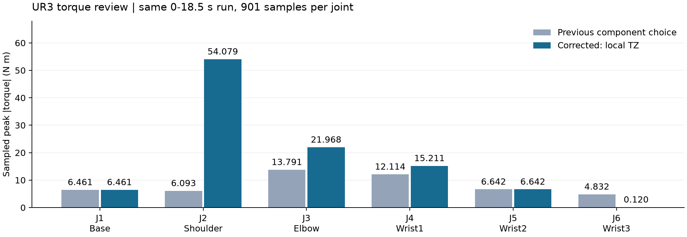

# UR3로 스크류를 세우고 베어링 끼우기

시스템동역학 수업에서 제공된 UR3 CAD를 바탕으로, 스크류를 세운 뒤 그 위로 베어링을 끼우는 경로를 RecurDyn으로 구성했습니다. 6개 관절의 모션과 부품을 잡고 놓는 시점을 정하고, Python으로 해석 결과를 읽어 어느 관절에 가장 큰 토크가 걸리는지 비교했습니다.



**어깨 관절(J2)의 두 막대를 보세요.** 같은 18.5초 해석의 901개 저장 시각에서 최대 절댓값은 Y축 성분으로 읽으면 6.093 N·m, 실제 회전축인 로컬 Z축으로 읽으면 54.079 N·m였습니다.

[모델의 조인트·모션 정의](model/SystemDynamics_UR3_pick_place_screw_bearing.rmd) · [토크 계산 코드](scripts/postprocess_results.py) · [솔버 원본 출력](results/solver/UR3_v81_clean_optimized.req) · [관절별 결과 CSV](results/motor_capacity_summary.csv)

## 어느 관절에 가장 큰 토크가 걸렸나

처음 계산한 표에서는 팔꿈치(J3)가 13.791 N·m로 가장 컸습니다. 모델을 다시 보니 네 관절에서 회전축 대신 Y축 모멘트를 읽고 있었습니다. 예를 들어 J2의 출력 기준은 192번 마커이고, 이 마커에서 관절이 도는 축은 Z축입니다.

후처리 코드에서 각 출력의 기준 마커를 조인트 정의와 대조하고 Z축 성분을 읽도록 바꿨습니다. 같은 원본을 다시 계산하자 스크류를 집어 올리는 구간인 **1.953초에 J2가 54.079 N·m**로 가장 컸습니다. 이 값은 지정한 경로를 따를 때의 관절 출력축 토크입니다.

[축을 고른 근거](docs/torque_review.md) · [처음 계산한 표](data/original/motor_capacity_summary.csv) · [6축 토크 시계열 그래프](assets/joint_torque.png)

## 베어링을 어떻게 정렬했나

스크류와 베어링에 각각 5개 경유점을 잡고, 집기와 놓기를 포함한 20개 자세를 관절 각도로 지정했습니다. 그리퍼는 하나의 강체로 모델링하고, 물체를 잡는 순간과 놓는 순간에 둘 사이의 구속을 켜고 껐습니다.

| 그리퍼 목표 위치 | 시각 (s) | X (mm) | Y (mm) | Z (mm) |
| --- | ---: | ---: | ---: | ---: |
| 베어링을 스크류 위에 정렬 | 14.25 | −250 | −245 | 341.7 |
| 베어링을 끼우는 위치까지 하강 | 16.05 | −250 | −245 | 234.7 |

삽입 구간에서는 X와 Y를 고정하고 목표 높이만 107 mm 낮췄습니다. 베어링을 놓은 뒤의 움직임은 수직 가이드로 표현했습니다. 이 모델로 확인한 범위는 지정 경로의 운동과 관절 하중까지입니다.

[경유점 좌표](data/pp_waypoints.csv) · [20개 자세와 관절 각도](data/joint_table.csv) · [그리퍼와 구속 모델](docs/model.md)

## 결과 다시 계산하기

Python 3.10 이상에서 아래 명령을 실행하면 원시 출력을 다시 읽어 저장된 시계열·요약 CSV와 검증 JSON을 대조합니다. 추가 패키지는 필요 없습니다.

```bash
git clone https://github.com/ktw25079/System_Dynamics.git
cd System_Dynamics
python scripts/postprocess_results.py --check
```

```text
PASS: six local-TZ requests, 901 samples per joint, 0-18.5 s; committed results match
```

동작 재생이나 솔버 재실행에는 RecurDyn 2023과 원본 RDYN이 필요합니다. 수업에서 제공한 CAD의 재배포 권한이 불분명해 형상이 포함된 RDYN은 별도로 보관했습니다. [재해석 절차](docs/reproduction.md)

## 파일 안내

| 폴더 | 내용 |
| --- | --- |
| [model](model/README.md) | 조인트·모션·출력 정의와 모델 파라미터 |
| [data](data/README.md) | 경유점, 관절 자세, 기하 여유, 정정 전 토크 |
| [results](results/README.md) | 원시 솔버 출력과 후처리 결과 |
| [scripts](scripts/README.md) | 토크 계산·검사와 그래프 생성 방법 |
| [docs](docs/README.md) | 과제 요구사항, 모델링 범위, 재현 절차, 정정 내역과 출처 |
| [assets](assets/README.md) | 토크 비교 그래프, 시계열 그래프, 작업 순서 개념도 |
